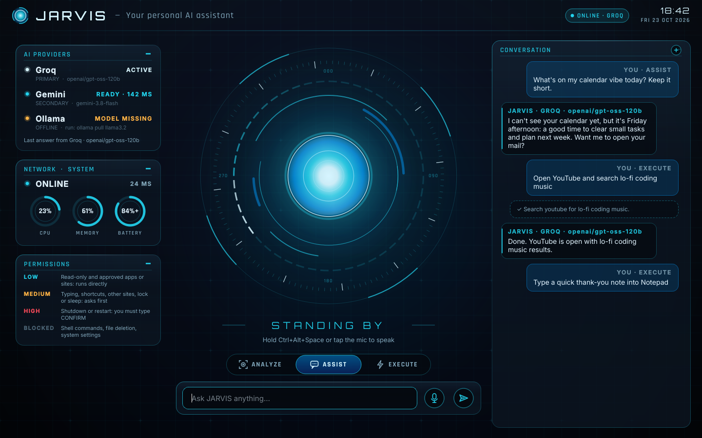
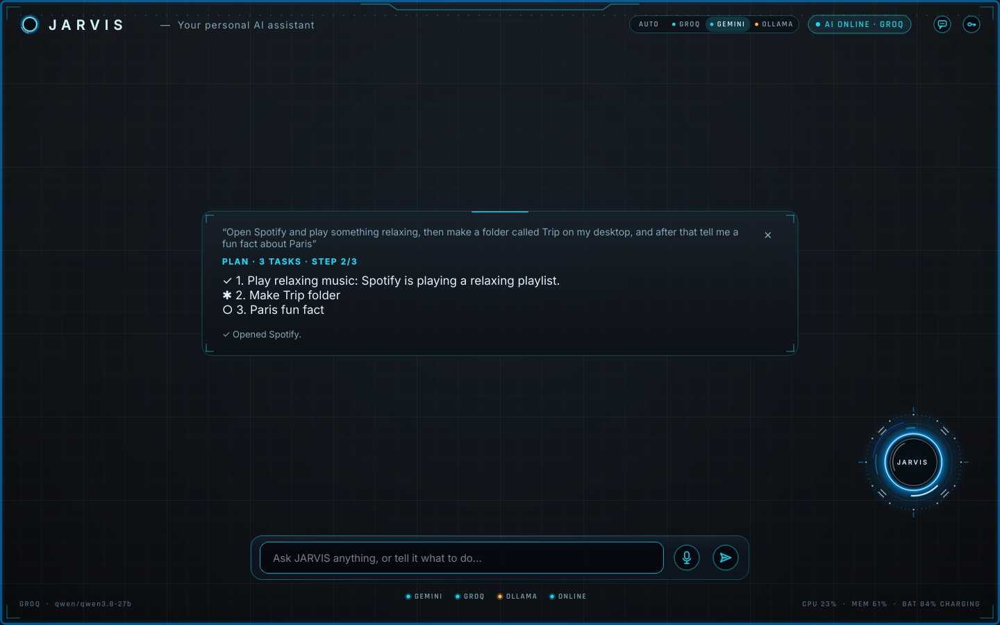

# JARVIS

A voice assistant and safe desktop agent for Windows 10/11, with a futuristic HUD.
Talk or type; JARVIS answers using **Groq** (primary), **Gemini** (backup) or **Ollama**
(offline on your PC), and can carry out narrowly scoped desktop actions with your permission.



More renders (listening, thinking, speaking, executing, confirmations, offline) are in
[`docs/renders`](docs/renders). Regenerate them with
`QT_QPA_PLATFORM=offscreen python scripts/render_ui.py`.

## Setup (Windows)

1. Install **Python 3.12 or newer (64-bit; 3.12, 3.13 and 3.14 are tested)** from python.org (tick "Add python.exe to PATH").
2. In this folder:

   ```powershell
   py -m venv .venv
   .\.venv\Scripts\Activate.ps1
   pip install -e ".[dev]"
   ```

3. Add API keys. The easiest way: start JARVIS and click the **key button** at the top
   of the AI PROVIDERS panel, then paste your keys. Or from a terminal:

   ```powershell
   setx GROQ_API_KEY "gsk_..."      # https://console.groq.com/keys  (primary, voice)
   setx GEMINI_API_KEY "AIza..."    # https://aistudio.google.com/apikey  (backup, reads the screen)
   ```

   Either way the keys are stored only as your Windows user environment variables, never
   in JARVIS files or logs, and JARVIS picks them up without a restart. Use either key,
   or both.

4. Optional, for offline use: install [Ollama](https://ollama.com) and run
   `ollama pull qwen3.5:4b`. JARVIS uses `qwen3.5:4b` for chat and, since it can see
   images, for screen questions too (thinking is turned off so replies stay quick). It is
   several times faster than `qwen3.5:latest` (the 9B, about 7 GB) on a laptop without a
   graphics card; if only `qwen3.5:latest` is installed, that one is used. If no model that
   can see is installed, any other installed model that can see images is used for the
   screen. If local replies stop mid-sentence, give Ollama more room: set the user
   environment variable `OLLAMA_CONTEXT_LENGTH` to `8192` and restart Ollama. To use
   another local model, put e.g. this in `%LOCALAPPDATA%\JARVIS\settings.json`:
   `{"providers": {"ollama": {"chat_model": "qwen3.5:latest", "vision_model": "qwen3.5:latest"}}}`

## Run

```powershell
python -m jarvis            # opens the window
python -m jarvis --hidden   # starts in the tray
```

- **Type** in the command bar and press Enter, or **talk**:
  - say **"Jarvis"**, wait for the orb, then speak. It sends when you pause. After it
    answers it **keeps listening**, so just say your next command, no wake word needed.
    After 30 s of silence (`voice.follow_up_s`) it goes back to waiting for "Jarvis";
    typing also ends the conversation. The wake word runs offline with Windows' own
    speech recognition (it needs an English speech language under Settings > Time &
    language > Speech), and it is paused while JARVIS is busy, so it never hears itself;
  - or hold **Alt+`** (the key left of 1) anywhere in Windows and let go to send;
  - or tap the mic button.

  Spoken questions get spoken answers.
  Speech is turned into text by Groq (or Gemini); with neither, the offline Whistle model
  (if you `pip install cactus-needle`) or Windows' own speech recognition is used. Names
  you've told JARVIS about, plus `voice.custom_words`, are passed along so they're spelled
  right.
- **Interrupt any time.** Press Esc in the window, choose Stop JARVIS in the tray, hold
  Alt+`, say "Jarvis" (it keeps listening for its name while it talks or works), or just
  type a new request: JARVIS stops talking and drops what it was doing. Saying or typing
  "stop" (or "never mind", "cancel that") ends it without asking the AI anything.
  Confirmations aren't cut off: they wait for your yes or no.
- **Dictation anywhere.** Hold **Alt+Shift+`**, speak, let go: your words are typed where
  the cursor is, in any app (pasted, with your clipboard put back afterwards). No AI
  answers and nothing is saved. It never types into shells, terminals or JARVIS itself,
  and never presses Enter. Change or turn off with `hotkeys.dictation`.
- When you call JARVIS while working in another app, only the **orb appears in the
  bottom-right corner**, above your other windows, with a short caption. It never steals
  focus, and it fades away when JARVIS is done. Click it to open the full window.
- **Pick the AI** with AUTO · GROQ · GEMINI · OLLAMA at the top, or just say it: "use
  Gemini from now on", "switch to the local model", "go back to automatic". The choice is
  remembered. If the chosen one isn't available, JARVIS says so and uses the next one,
  and every answer is labelled with the provider that really produced it.
- **Answers without the wait.** A local reply is spoken while it's still being written,
  sentences follow each other without gaps, and JARVIS knows you've finished after 0.6 s
  of quiet (`voice.end_silence_s`; `voice.speak_while_writing` turns streaming off).
- **Local first.** Everyday conversation (questions, explanations, advice, writing) is
  answered on your PC by Ollama's `qwen3.5:4b`, then `gemma3:4b`, so it's free, private
  and works offline. Anything that needs to act on the PC, see the screen, or know
  something current goes to the cloud, and so does anything the local model hands back.
  Choosing a provider ("use Groq from now on") overrides this; `routing.local_first`
  turns it off.
- **Automatic fallback:** Groq, then Gemini, then OpenRouter (if you add a key), then
  your local `qwen3.5:4b`. Inside Groq, a rate-limited qwen hands over to MiniMax M2.7
  (a strong agentic model, free on Groq), then GPT-OSS 120B and Llama 3.3 70B; Gemini
  uses 3.5 Flash-Lite, then 3.8 Flash, 3.6 Flash and 2.5 Flash. **OpenRouter** is
  optional (`OPENROUTER_API_KEY`, free at openrouter.ai): it starts on a free model that
  can also see the screen (`nvidia/nemotron-3.5-super-vl:free`), and you can point
  `providers.openrouter.chat_model` at a paid model such as `moonshotai/kimi-k3` (very
  capable, but paid per use and slower to start). Nothing heavy runs on your PC. A timeout, a rejected key or a
  billing problem moves on to the next service at once. While it works, the caption says
  who it's asking ("Groq didn't answer, asking Gemini…"), and a note says why a backup
  answered.
- **Something not answering?** Say or type "test the AI providers", or press TEST AI
  PROVIDERS in the details panel. Each AI gets a one-word request (each of its models in
  turn, until one answers; that one is used from then on), and JARVIS tells you
  exactly what each one said back and whether the problem is on your account (key, quota,
  billing), on their servers, your network, or JARVIS.
- If a command **can't be carried out** (a tool fails, you decline it, JARVIS says it
  can't, or no AI can answer), the whole UI turns red for a few seconds, including the
  corner orb and its caption, then goes back to blue.
- **Context aware.** Each request includes the window you're working in, your other open
  windows and what JARVIS did recently, so "close this", "copy it to my desktop" or
  "undo that" work without spelling everything out.
- **No modes to pick.** JARVIS works out what you want from what you say:
  - Ask about your screen ("what's this error?", "summarise this page") and it takes a
    screenshot (hiding itself first) and answers about it. Press Enter with an empty box
    to just describe the screen. Needs Gemini or an Ollama model that can see images.
  - Ask a question or for writing or planning, and it just answers.
  - Ask it to do something, and it uses its tools: open apps, games and sites, search
    the web, create, find, copy, move, rename and delete (to the Recycle Bin) files and
    folders, copy and paste, about 80 named keyboard shortcuts (media, Windows, editing,
    browser) plus any other key combination, type dictated text into the window you
    were using, lock, sleep, and delayed shutdown or restart. Risky actions still ask
    first.
- **Long requests become a task list.** Ask for several things at once ("open Spotify
  and play something relaxing, then make a folder called Trip on my desktop, and after
  that tell me a fun fact about Paris") and JARVIS first splits it into tasks, shows them
  in the card, then works through them one by one, ticking each off (✓ done, ✱ working,
  ✕ didn't work). Risky steps still ask first. If one task fails the others still run,
  and the summary at the end (and the red tint) says which one didn't work. Short
  requests skip the planning step.



- **Tasks and ideas, captured instantly.** "Add a study task: revise chapter 4 due
  Friday", "idea: a plant-watering bot", "add milk to my shopping tasks", "quick note:
  parked on level 3" are saved straight away with no AI involved (notes go to the Inbox
  note in your memory folder). "What's pending?", "mark the chapter 4 task done" and
  "what ideas did I have about robots?" work too. Kept on your PC with the rest of
  JARVIS's memory. Requests for another app ("create a task in Notion…") are left to
  that app.
- **Workflows.** One phrase, several steps. Open the builder from the tray (Workflows…)
  or say "open the workflow builder": pick what starts it (a phrase you say, a time of
  day, JARVIS starting, or only when you run it), add steps from the menu (open a
  folder, file, app or website, show pending tasks, start a timer, show a checklist,
  say something, give the briefing, save a note, find files, read a document, save
  text, ask JARVIS, make a deck, ask before going on, wait, or run any tool), edit
  their settings, drag or move them up and down, Test, then Save. Templates: Study Mode,
  Start work, Development environment and Prepare my presentation. Or describe it:
  "Whenever I start work, open my project folder and show my pending tasks." JARVIS
  shows the workflow it would make and saves it only if you say yes. Then saying
  "activate study mode" runs every step on the card, ticking each off; risky steps
  still ask first, an "ask before going on" step you say no to skips the rest, and a
  step can use the one before it (`{previous}`, `{step 2}`, `{today}`), so a workflow
  can be a **command chain** (find the sources, pull out the key points, write the
  outline, save it, make the deck). Workflows live in `workflows.json` in JARVIS's data
  folder.

- **Remembers you.** Tell it "my sister is Ayşe" or "I live in Kochi" and it keeps that
  on your PC (`keep.sqlite3`), uses it later, and forgets it when you ask. After each
  conversation it also picks up lasting facts you mentioned on your own.
- **Never forgets a conversation.** Everything also goes into a folder of plain
  Markdown notes, **Documents\JARVIS Memory**, that you can open in Obsidian ("Open
  folder as vault") or any editor: `Daily/` has every exchange and a summary of each
  conversation, one note per day; `JARVIS/Facts.md` lists what it remembers about you;
  `Notes/` holds notes you ask it to take ("note down the trip plan"). Before every
  answer JARVIS searches the whole folder, your own notes included, and gives the AI
  the few passages that match ("what did we decide about the car yesterday?"), so you
  don't repeat yourself. The search runs on your PC with no AI; only the matching
  passages are sent with your request. Settings: `memory.*` (folder, on/off, how much is
  recalled). If you run a [Hindsight](https://github.com/vectorize-io/hindsight) memory
  server, set `memory.hindsight_url` and JARVIS uses it too.
- **Live prices and facts from free public APIs.** "What's the Nifty at?", "Reliance
  share price", "bitcoin in rupees", "gold rate per gram", "NAV of Parag Parikh Flexi
  Cap", "convert 250 dollars to rupees", "tell me about the Chola dynasty" (Wikipedia),
  "what does ephemeral mean", "how's the air in Delhi", "any big earthquakes today",
  "next public holidays", "tell me a joke". Sources: Yahoo Finance, CoinGecko,
  Frankfurter (ECB rates), mfapi.in, Wikipedia, dictionaryapi.dev, Open-Meteo, USGS,
  Nager.Date, JokeAPI; no keys needed, and each answer names its source. Gold and silver
  are the international spot price (Indian shop prices add duty and GST). "Watch
  bitcoin and tell me if it moves 3%" checks every 30 minutes, and the morning briefing
  reads `routines.briefing_markets` (Nifty, Sensex and gold by default).
- **Watchtower.** "Watch my Downloads for new PDFs", "tell me when anything in
  Documents\Projects changes", "what are you watching?", "stop watching Downloads", or
  the Watchtower tab (tray › Workflows and Watchtower…, or "open Watchtower"). JARVIS
  lists those folders every 30 seconds on your PC (it never opens the files) and
  mentions new or changed files once they've finished downloading or saving. Only
  folders inside your own folders can be watched. A workflow can start from a folder
  too ("When a new PDF is in Scans": its steps can use `{file}`). It also gives one
  heads-up for each task deadline (the day before, an hour before, and when it's
  overdue) and ten minutes before calendar events; both can be switched off in the tab
  or under `watchtower` in settings.json.
- **Reminders and timers.** "Remind me at 6 pm to call Mom", "set a 10 minute timer",
  "remind me every weekday at 9 to check mail": it says them out loud when due, even
  after a restart, and a repeating one sets itself up again (daily, weekdays, weekly,
  monthly).
- **Your day.** "Plan my day" gathers your calendar, overdue and due tasks and today's
  reminders, then gives three priorities and a time-blocked plan. "Review my day" says
  what got done, what's still open and the first three things for tomorrow, and saves
  it as a note. "Brief me" gives the morning briefing on demand; the automatic one now
  includes your calendar and tasks due. "What's on my calendar tomorrow?" works too.
  **Calendar (read-only):** copy your calendar's secret iCal address (Google Calendar:
  Settings › your calendar › "Secret address in iCal format"; Outlook: Publish calendar
  › ICS) into the `JARVIS_CALENDAR_ICS` environment variable, e.g.
  `setx JARVIS_CALENDAR_ICS "https://calendar.google.com/calendar/ical/.../basic.ics"`.
  Several addresses can be given separated by spaces. JARVIS never writes to it.
- **Weather, news and web answers.** "Will it rain tomorrow?", "latest news on the
  election", "what's the price of a PS5?": it reads the results and answers, saying
  where it came from. "Keep an eye on news about SpaceX" checks once a day.
- **Speaks up when it matters.** The first time you're at the PC each morning, a short
  briefing: the date, your city's weather, today's reminders, a line on what you did
  last time, and a few headlines. It also mentions news on topics you asked it to
  watch, warns about a low battery or a PC that's been flat out for minutes, and after
  two hours without a break suggests one (never during quiet hours, 22:00 to 08:00).
  Each of these can be turned off under `routines` in settings.json.
- **Entertainment and errands.** "Play lo-fi on YouTube" plays the top result; "find
  flights from Kochi to Dubai on 12 March" opens Google Flights; "what Steam games do I
  have?", "start Cyberpunk", "update my games". "How do I look?" takes one webcam photo
  after you say yes, and it's never saved.
- **Feels responsive.** A spoken request that takes a moment gets a quick "On it.", it
  won't mistake its own voice for you during a conversation, and "Start with Windows"
  in the tray menu starts it quietly in the tray when you sign in.
- **Power tools, each asking first.** "Switch to dark mode", "turn Wi-Fi off". "Use
  Python to work out…": JARVIS writes a short program, shows it, and runs it only after
  you type CONFIRM, in its own folder (`%LOCALAPPDATA%\JARVIS\code`), for 30 seconds at
  most, without your API keys, and never one that starts programs or deletes files.
- **Plugins.** Drop a `.py` file into `%LOCALAPPDATA%\JARVIS\plugins` to give JARVIS a
  new tool (see `jarvis/tools/plugins.py` for the three-line format). A new or changed
  file is shown to you and loads only after you type CONFIRM.
- **Phone dashboard.** Say "pair my phone" (or Pair a phone… in the tray menu), open the
  address it shows on your phone (same Wi-Fi) and enter the one-time code. Then you can
  follow what JARVIS is doing and send it requests from the phone. It's off until you
  pair, risky steps are still confirmed on the PC, and Unpair phones in the tray turns
  it off again.
- **Undo.** "Undo that" takes back JARVIS's own last file move, rename, copy, new folder
  or file, desktop tidy-up, or volume, brightness or wallpaper change.
- **Documents and your PC.** "Summarise the PDF in my Downloads", "save these notes to
  my desktop", "tidy up my desktop", "set the volume to 30", "dim the screen", "make
  space.png my wallpaper", "close Spotify". If an app is already open it is brought to
  the front instead of opened twice, and JARVIS only says an app opened once its
  window has actually appeared.
- **Document Assistant.** "Summarise the PDF I'll upload", "what are the action items
  in minutes.docx?", "explain this paper simply", "make study notes from chapter3.pdf",
  "what does the contract say about notice periods?". Name the file, drop it on the
  window, or pick it when asked. Long documents are covered from start to end, and
  "save it" keeps the result in Documents\JARVIS Writing.
- **Research Agent.** "Research whether heat pumps are worth it in Kerala" searches the
  web, reads the best pages (more with "deep research"), leaves out any page that looks
  like it's trying to give JARVIS instructions, and writes a report where every claim
  carries a numbered citation, with the real source list at the end. Saved in
  Documents\JARVIS Research and opened.
- **Writing Assistant.** "Write a cover letter for the data analyst job at Infosys",
  "draft a short speech for my sister's wedding", "write a report from notes.md": a new
  Word file in Documents\JARVIS Writing (never overwriting one), opened for you, with
  [placeholders] for details it doesn't know. For shorter things ("rewrite this email
  more politely") it just answers.
- **Email Assistant (reads, never sends).** "Summarise my unread email", "any action
  items in my inbox?", "what did Priya say about the budget?", "draft a reply to Priya
  saying I'll send it Thursday". JARVIS reads your inbox without marking anything as
  read, and a reply is only ever saved to your **Drafts** folder after you've seen it
  and said yes; you send it yourself. There is no sending code in JARVIS. To connect
  Gmail: turn on 2-step verification, make an app password at
  myaccount.google.com/apppasswords, then `setx JARVIS_EMAIL_ADDRESS "you@gmail.com"` and
  `setx JARVIS_EMAIL_PASSWORD "the 16-letter app password"` and restart JARVIS (other
  providers: also `JARVIS_EMAIL_IMAP`, e.g. `imap.zoho.in`). The "Email triage" template
  ("check my email") gives a summary, action items and what needs a reply.
- **Decision Assistant.** "Should I buy the MacBook Air or the ThinkPad?", "help me
  decide between these two job offers": the goal in a line, the options, weighted
  criteria in a small table, risks, and a clear recommendation with how sure it is and
  what would change it, looking up current prices or facts first when the choice
  depends on them.
- **Troubleshooting Assistant.** "My laptop is really slow", "the Wi-Fi keeps
  dropping", "my disk is full", "Spotify keeps crashing": JARVIS runs a read-only
  check (uptime, CPU and memory with the busiest programs, disk space, battery,
  network, DNS and internet, recent Windows error events), then gives the likely cause
  and steps from the quickest to the more involved. It changes nothing by itself and
  offers only fixes it already has tools for, asking first.
- Long documents, research and writing use the same free OpenRouter models as the decks
  (then Groq for short ones, then the usual providers), and say which model wrote them.
- **PowerPoint decks, free models only.** "Make a 12 slide presentation on black holes",
  or "make a 20 slide ppt for the pdf I'll upload": a file picker opens (or drop the file
  on the JARVIS window first, then ask). The deck is written by a free OpenRouter model
  (needs `OPENROUTER_API_KEY`, free at openrouter.ai/settings/keys; about 50 decks a day
  without credit), with Groq's free GPT-OSS 120B as the backup for short topics. Never
  Gemini, Ollama or a paid model. JARVIS draws it as a real .pptx (16:9, six themes,
  title, agenda, section, icon cards, stats, editable charts, timeline, comparison
  table, statement, quote and closing slides, speaker notes on every slide), saves it in Documents\JARVIS Presentations and opens it.
  PDF, Word, PowerPoint, Excel, text and Markdown files can be the source.
- **WhatsApp messages.** Ask "send Mom a WhatsApp message saying I'll be late": after
  one Yes, JARVIS brings WhatsApp to the front, searches for the chat (Ctrl+F), opens
  it, pastes the message and presses Enter. It stops if WhatsApp isn't the window in
  front, and tells you if it couldn't see the contact's name in the opened chat.
- **Works inside apps.** Ask "add milk to my shopping list in Notepad" and
  JARVIS opens the app, reads its window (buttons, search box, chats, message box) with
  Windows' accessibility interface, then clicks and types step by step, checking the
  window after each step, until it's done. It asks before anything that sends, pays,
  deletes or calls, and before pressing Enter to send. It never touches shells,
  terminals, Windows Settings, Task Manager or password fields, and text it reads in
  apps is checked for hidden instructions like everything else. Buttons, menus, links,
  checkboxes and tabs are pressed through the accessibility interface itself (works
  even when they're partly covered), and if a click changes nothing or typed text
  doesn't show up, JARVIS notices and checks again instead of carrying on.
- Answers appear in a card in the middle while the orb moves to the corner; close the
  card (or start a new question) and the orb returns. The chat button at the top right
  opens the full history; click the status dots at the bottom for providers, network and
  safety details.
- Each answer is labelled with the provider and model that actually produced it.
- Closing the window keeps JARVIS in the tray. Quit from the tray icon.

## Safety

| Level | Examples | Behaviour |
|---|---|---|
| Low | reading an app's window, clicking and typing in it, typing text, copy, cut, paste, undo, most key combinations, time, system status, opening installed apps and games, trusted sites, web search, media keys, listing, finding, opening and copying files, creating folders, the clipboard | runs directly |
| Medium | sending a message (Enter or a Send/Pay/Delete/Call button), keys that send, save, delete or close (Enter, Delete, Alt+F4, Ctrl+W, Ctrl+S), moving or renaming files, deleting a file, tidying the desktop, dark mode, Wi-Fi, untrusted sites, lock, sleep | asks out loud: say yes or no. JARVIS stays on the app it's working in; the buttons only come forward if it can't hear you |
| High | deleting a folder, shutdown or restart (60 s delay, cancellable) | you must type CONFIRM |
| Blocked | shell commands, running programs or scripts from files, system folders, the registry and system settings, Win+R, Win+X, Ctrl+Alt+Del | no such tool exists, or refused |

Text that comes from outside (clipboard, folder listings, the screen description,
window titles) is checked by Meta's **Llama Prompt Guard 2** on Groq before the chat
model sees it. If it looks like an attempt to give JARVIS orders, it is withheld and the
UI turns red. (Prompt Guard is a classifier, so it doesn't answer; qwen still does.)

File tools only work inside your own folders (your user folder and any drive that isn't
the Windows drive), never in Windows, Program Files, ProgramData or AppData, and links
are resolved first so they can't point elsewhere. Nothing is deleted outright: it goes to
the Recycle Bin, and your main folders (Desktop, Documents, Downloads...) can't be removed.
Copy and move never overwrite. Opening a file uses its default app and never runs `.exe`,
scripts, installers or shortcuts.

JARVIS can open anything installed on the PC that the Start menu lists (games such as
Valorant included), plus the built-in shortcuts in `approved_apps`. It opens them the way
the Start menu does, through the shortcut or the app's Windows ID. Shells and system
editors (PowerShell, Command Prompt, terminals, WSL, Registry Editor, Services) are never
opened. Only http(s) URLs can be opened, and nothing runs a command line written by the
model. Text read from the screen is treated as data, never
as instructions.

## JARVIS's voice and manner

JARVIS speaks with a refined British male voice that runs **on your PC**: free, offline
and unlimited, with no account or API key. It uses the open Kokoro speech model (Apache
2.0). The first start downloads the model once (about 350 MB, into
`%LOCALAPPDATA%\JARVIS\voices`, checked against a fixed checksum); Windows' own voice
speaks until it's ready, and takes over again if the model ever can't run.

It is a stock voice chosen to sound like the film's composed English AI, not a copy of
the actor's voice (cloning a real person's voice without permission isn't something
JARVIS does). Four British male voices are included; set `voice.neural_voice` to try them:

| Voice | Notes |
|---|---|
| `bm_george` (default) | the best-rated British male voice in Kokoro's own list |
| `bm_fable` | also rated well; worth comparing with George |
| `bm_lewis`, `bm_daniel` | rated lower by Kokoro's authors, but some prefer them |

`voice.neural_speed` sets the pace (1.15 by default; lower is slower and more measured; 0.7 to 1.3). Set
`voice.tts_engine` to `"sapi"` to use only Windows' voice, or `voice.download_voice` to
`false` to never download. A short pause separates sentences, and Markdown, links, code,
emoji and file paths are never read aloud (a link becomes the site's name).

Replies, task reports and notices follow one personality: composed, concise British
English that leads with the result, with the odd dry remark, and it never claims to have
done something its tools didn't actually do.

## Settings

`%LOCALAPPDATA%\JARVIS\settings.json` (created when you first save settings; defaults apply
otherwise). You can change provider priority, model names, timeouts and retries, approved
apps, trusted sites, the hotkeys (`hotkeys.push_to_talk`, default ``alt+` ``;
`hotkeys.dictation`, default ``alt+shift+` ``), the wake word (`voice.wake_word`,
`voice.wake_phrases`, `voice.wake_min_confidence`: `low`, `normal` or `high`), how long it keeps listening for
follow-ups (`voice.follow_up_s`, 0 to turn off), the voice (see above) and the deck maker
(`slides.models`: free OpenRouter models tried in order, ids ending in `:free` only;
`slides.groq_model`; `slides.max_slides`, default 30; `slides.folder`;
`slides.open_when_done`). Conversation history is stored in
`%LOCALAPPDATA%\JARVIS\jarvis.sqlite3`; logs are in `%LOCALAPPDATA%\JARVIS\logs` and never
contain your messages, audio or keys.

## Ideas borrowed (no code copied)

- [Handy](https://github.com/cjpais/handy) (MIT): the dictation hotkey and custom words.
- [Cactus Whistle](https://cactuscompute.com/blog/whistle) (Apache-2.0): optional offline
  speech-to-text.
- [cua](https://github.com/trycua/cua) (MIT): pressing controls through accessibility
  patterns and checking each action's effect.
- [public-apis](https://github.com/public-apis/public-apis) (MIT): the list the live-data
  sources were picked from.
- [Hindsight](https://github.com/vectorize-io/hindsight) (MIT): keyword plus time-based
  recall fused into one ranking; an optional connector to a Hindsight server.
- [Open Glean](https://github.com/hydra-db/open-glean) (Apache-2.0): answers from your
  notes that name the note they came from.
- Mark-LVI (CC BY-NC 4.0): WhatsApp sending and several features, reimplemented.

## Develop

```powershell
ruff check . ; ruff format --check . ; mypy ; pytest
```

Fonts: Orbitron, Rajdhani and Inter, bundled under the SIL Open Font License
(`jarvis/assets/fonts`).
